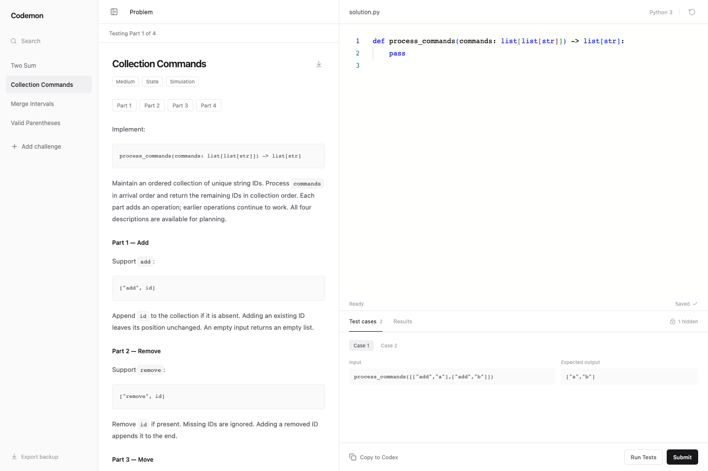

<p align="center">
  
</p>
<h1 align="center">Codemon</h1>
<p align="center">A quiet place to practice Python. Add a question, write a solution, run the tests.</p>
<p align="center"><a href="#get-started">Get started</a> · <a href="#add-a-challenge">Add a challenge</a> · <a href="#build-and-package">Build and package</a></p>



Codemon is a local-first coding playground built with React, Monaco, and react-py. Python runs in a Web Worker through Pyodide. Questions, public tests, hidden tests, and multipart assessments are plain JSON; adding an exercise takes no app changes.

- **Minimal workspace.** Collapsible library, problem statement, Python editor, and test results.
- **Useful feedback.** Individual pass/fail results, Python errors, return values, and captured `print()` output per test.
- **Saved drafts.** Your current code, selected question, and progress survive reloads and server restarts.
- **Progressive questions.** Read all parts up front, submit each stage, and continue with the same code.
- **Copy to Codex.** Copy the question, solution, current tests, and latest results for review, with hidden expected outputs omitted.
- **Portable library.** Import challenge JSON in the sidebar; export and restore workspace backups.

## Get started

Requires **Node.js 22.12+** and npm. Python runs in the browser; a local Python installation is needed only for the automated runner tests.

```sh
git clone https://github.com/rayanical/codemon.git
cd codemon
npm ci
npm run dev
```

Open **http://127.0.0.1:5173**. The port is fixed so drafts stay associated with the same browser origin.

The starter library includes Two Sum, Valid Parentheses, Merge Intervals, and Collection Commands, a four-part exercise.

| Action        | Behavior                                                                                                               |
| ------------- | ---------------------------------------------------------------------------------------------------------------------- |
| Run Tests     | Runs public cases for a single-part question. For multipart questions, runs all cases through the active stage.        |
| Submit        | Runs public and hidden cases through the active stage. A passing submission marks completion or enables the next part. |
| Reset         | Replaces the current draft with starter code and autosaves that change.                                                |
| Copy to Codex | Copies review context to the clipboard. Nothing is sent automatically.                                                 |

Hidden results show the input, your output, errors, and terminal logs. Expected outputs remain hidden in the interface and review copy.

> [!IMPORTANT]
> Drafts and imported questions live in your browser’s `localStorage`, not on the development server. Keep the same browser profile, hostname, and port. Clearing site data removes them. Use **Export backup** before moving browsers, changing origins, or clearing storage. Restarting the server does not remove drafts.

## Add a challenge

Either paste JSON using **Add challenge** in the sidebar, or create a file in `src/challenges/` to include it in the public library. A stable `id` links the question to its saved draft.

```json
{
  "id": "sum-values",
  "title": "Sum Values",
  "difficulty": "Easy",
  "topics": ["Arrays"],
  "functionName": "sum_values",
  "description": "Return the sum of the integers in `values`. An empty list returns `0`.",
  "constraints": ["0 <= len(values) <= 1000"],
  "starterCode": "def sum_values(values: list[int]) -> int:\n    pass\n",
  "tests": [
    {
      "id": "sample",
      "name": "Several values",
      "args": [[1, 2, 3]],
      "expected": 6,
      "hidden": false
    },
    {
      "id": "empty",
      "name": "Empty input",
      "args": [[]],
      "expected": 0,
      "hidden": true
    }
  ]
}
```

`args` contains positional arguments passed to `functionName`. Expected values use JSON types and are compared with the original Python return value using Python equality: a tuple does **not** satisfy a list expectation. Judging checks the returned value; `print()` is for debugging.

Descriptions support paragraphs, inline backticks, and fenced code blocks. Use inline code for identifiers and fenced blocks for signatures, formats, and multiline rules. Other Markdown syntax is not rendered.

For multipart questions, add a `stages` array of `{ "title", "description" }` objects and a one-based `stage` on every test. Each stage needs a public case. Tests accumulate through the active stage, all descriptions remain visible, and advancement is manual after a passing Submit. See [Collection Commands](src/challenges/collection-commands.json) for a complete example.

Optional `reviewInstructions` customize the review prompt for a particular exercise. The [challenge authoring skill](skills/codemon-challenges/SKILL.md) documents the full workflow for coding agents, including formatting and test semantics.

### Keep personal questions private

Put personal exercises in **`local/challenges/*.json`**. The development server discovers them automatically. This folder is gitignored, excluded from production builds, and excluded from release packages. Imported questions and drafts remain in browser storage and are never bundled.

Public questions belong in `src/challenges/`. Avoid committing personal backups or credentials; `local/`, backup JSON files, `.env` files, and generated artifacts are ignored.

## Build and package

```sh
npm run build       # Typecheck and build the public app into dist/
npm run preview     # Preview the build at http://127.0.0.1:4173
npm run package     # Build and create artifacts/codemon-1.0.0.tgz
```

The archive contains `package/dist/`, `package/skills/codemon-challenges/`, the README, and package metadata. Serve the contents of `dist/` from the root of any static HTTP host. There is no application server or database to deploy. The npm package is marked private to prevent accidental registry publication.

> [!NOTE]
> Monaco and Pyodide load runtime assets from external CDNs, so first load requires internet access. This is a practice playground: client-side hidden tests are an interface convention, not secret grading infrastructure. The browser downloads their expected outputs. Python runs off the UI thread, but a Web Worker is not a security boundary for hostile code. Runs are stopped after ten seconds.

### Bundled authoring skill

The repository and release archive both include `skills/codemon-challenges/SKILL.md`. From the repository root (or the extracted archive’s `package/` directory), install it for Codex with:

```sh
mkdir -p ~/.codex/skills
cp -R skills/codemon-challenges ~/.codex/skills/
```

Use the skill from a source checkout when authoring questions: it reads the app’s types and validator to keep generated exercises compatible. Personal exercises belong in gitignored `local/challenges/`.

## Development

```sh
npm run check                 # Formatting, challenge validation, unit tests, production build
npm run format                # Format tracked project sources
npx playwright install chromium
npm run test:browser          # With npm run dev running in another terminal
```

Runner tests require **Python 3.10+** available as `python3`. Browser checks use isolated storage to verify responsive layout, multipart navigation, immediate-reload autosave, reset persistence, hidden-output concealment, and per-test logs. Set `CODEMON_TEST_URL` to check a different server, such as the production preview. To use an installed Chrome instead of downloading Chromium, set `CODEMON_BROWSER_CHANNEL=chrome`.

| Location                                | Responsibility                                        |
| --------------------------------------- | ----------------------------------------------------- |
| `src/challenges/`                       | Declarative public questions                          |
| `src/challenge-format.mjs`              | Shared challenge validation                           |
| `src/challenge-session.mjs`             | Stage selection and review redaction                  |
| `src/runner.mjs`                        | Python test harness and result transport              |
| `src/useWorkspace.ts`, `src/storage.ts` | Debounced autosave and backup compatibility           |
| `src/App.tsx`                           | Workspace UI and worker orchestration                 |
| `vite.config.ts`                        | Build configuration and react-py worker compatibility |

`react-py` is pinned to `1.11.7`: the Vite compatibility plugins prevent duplicate runtime initialization and bundle its classic worker correctly during development. Recheck these plugins when upgrading the runtime.
